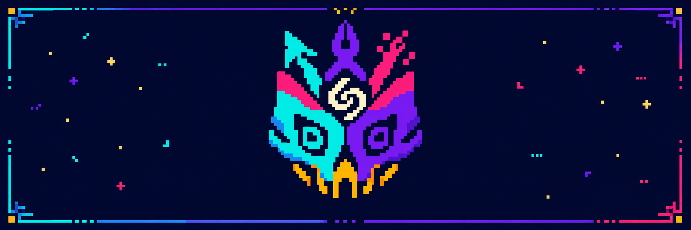

<p align="center"></p>

# Lagann

A design director skill for Claude Code. Lagann gives the agent design judgment instead of a house style:
it reads what your product already is, picks the right amount of process for the task, pulls in the
right expertise at the right moment, avoids generic AI-looking design, and checks the result in a real browser.

## What it does

- **Reads your product first.** Tokens, type, motion and past decisions come from your code and are kept
  in a short `.design-lagann/context.md` per project.
- **Scales to the task.** A button fix gets a checklist; a new product gets four stages:
  Discover → Imagine → Construct → Verify.
- **No default style.** Every visual direction comes from the subject, never from a preset.
- **Anti-slop.** It catches generic patterns, and also the "cream and serif" overcorrection, without
  breaking what already works.
- **Honest verification.** It renders at real widths, separates defects from style choices, and never
  reports a check it didn't run.

## Install

```bash
git clone https://github.com/Oldiiik/Design-Lagann.git
cp -r Design-Lagann/skills/lagann ~/.claude/skills/
```

Start a new Claude Code session. Lagann triggers on its own for UI work; you can also call `/lagann`.

## Usage

Just ask:

- "Build a landing page for my bike repair co-op"
- "Make the dashboard for our clinic's front desk"
- "This page feels generic, why?"
- "Fix the dropdown, it has no focus state"

## Modes

| You ask | Lagann does |
|---|---|
| Something new | **Create**: all four stages |
| A small change | **Modify**: the change, plus the checks that matter |
| "Improve this page" | **Redesign**: audit first, keep what's distinctive |
| "Does this look good?" | **Audit**: diagnose only, no edits |
| Feature work touching UI | **Continuous QA**: regression checks |

## Works better with

Lagann works on its own and goes deeper when these skills are installed, using only the parts it needs:
impeccable, taste-skill, frontend-design, ui-ux-pro-max, emil-design-eng, animate, apple-design,
designing-user-experiences, web-design-guidelines.

## Structure

```
skills/lagann/
  SKILL.md        entry point
  stages/         discover, imagine, construct, verify
  modules/        modes, anti-slop, specialists, conflicts, project context
  references/     craft defaults, worked examples
  standards/      accessibility, performance, SEO, security
  checklists/     small-change checks, report formats
  scripts/        context scan, browser inspector, browser checks
```

## License

Apache-2.0
